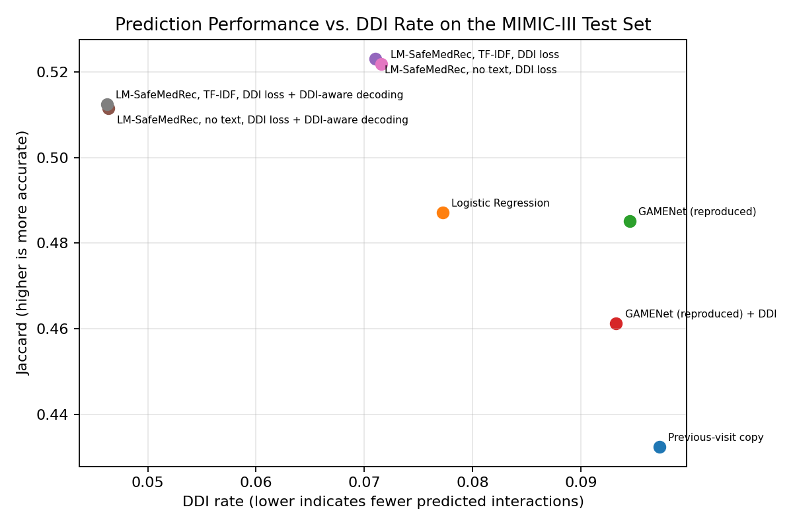

# LM-SafeMedRec

Safe medication recommendation from hospital records, using a Transformer over a patient's visit history and text embeddings of medical code descriptions.

Given a patient's diagnoses and procedures at the current hospital visit, and their earlier visits, the model recommends a set of drug classes (ATC level 4). It is evaluated based on how closely its recommendations match the drugs actually prescribed (Jaccard, F1, PR-AUC) and how many recommended drug pairs are known to interact (DDI rate, where a lower value indicates fewer predicted drug–drug interactions).

## Starting point

This project builds on **GAMENet** (Shang et al., AAAI 2019). The experiments reported in this repository use the processed MIMIC-III dataset and patient split released with the original GAMENet repository. The original GAMENet model and evaluation metrics were reimplemented in a current PyTorch environment to provide a baseline comparison.

The DDI loss controller follows **SafeDrug** (Yang et al., IJCAI 2021).

DDI rate is an experimental metric, not a guarantee of clinical safety. The model is intended for research evaluation and not for clinical decision-making.

The processed dataset was obtained from the public GAMENet repository. Researchers reproducing this work should obtain their own authorized access to MIMIC-III and follow the applicable data-use agreement. Public availability of processed files does not itself establish permission to redistribute them.

## GAMENet Reproduction

We implemented a GAMENet-based baseline inspired by Shang et al. (AAAI 2019), incorporating diagnosis and procedure embeddings, dual GRU-based visit encoders, graph convolution over EHR and DDI networks, and dynamic medication memory. The implementation was adapted to current PyTorch APIs and evaluated using the experimental pipeline developed for this project. Because training duration, preprocessing, and implementation details may differ from the original study, results are reported as a project-level reproduction rather than an exact replication of the original published results.

## What I changed

| | GAMENet (original) | LM-SafeMedRec (this project) |
|---|---|---|
| Visit history encoder | Two GRUs | Causal Transformer (2 layers, 4 heads, visit-position embeddings) |
| Code embeddings | Learned ID only | Learned ID + gated projection of a text embedding of the code's description |
| Drug representation | GCN over co-prescription and DDI graphs | Drug ID + text embedding, refined over the co-prescription graph |
| Use of past prescriptions | Memory read weighted by visit similarity | Explicit attention over past visits with a learned weight per drug (inspectable) |
| Safety | DDI memory + annealed DDI loss | SafeDrug-style controllable DDI loss + optional DDI-aware decoding at test time |
| Training | One optimizer step per visit prefix | One step per patient, all visits predicted at once (causal masking) |

Text embeddings are an additional component of LM-SafeMedRec, intended to provide semantic information beyond learned medical code IDs. A diagnosis code like `4280` is just an index to GAMENet, so a code seen only a handful of times in training gets a poor embedding. The description ("Congestive heart failure, unspecified") provides additional semantic information beyond the diagnosis code itself. Depending on the embedding method, descriptions with similar meanings may receive similar representations. The gating mechanism allows the model to learn, dimension by dimension, how much to rely on the text representation versus the learned ID embedding.

Text sources: ICD-9-CM v32 diagnosis and procedure descriptions (CMS) and WHO ATC names. Exact description matches were obtained for 1,903 of 1,958 diagnosis codes and 1,419 of 1,430 procedure codes. Remaining codes use parent-category descriptions where available. Drug-class descriptions are retrieved using exact or parent-category matching, with fallback labels when no description is available.

## Data

MIMIC-III as processed by GAMENet: 6,350 patients, 15,032 visits, 1,958 diagnosis codes, 1,430 procedure codes, 151 drug classes, 467 interacting drug-class pairs (from TWOSIDES). Patients average 2.37 visits and 19.9 drugs per visit. Split: 4,233 train, 1,059 validation, 1,058 test. The real prescriptions have a DDI rate of 0.0845 in training and 0.0750 in test.

MIMIC-III is credentialed data. For any publication, get your own access through PhysioNet and regenerate the files with GAMENet's preprocessing.

The processed patient-level files used in the reported experiments are not included in this repository. The `scripts/get_data.sh` script only creates the required local directories; it does not download patient records or processed GAMENet pickle files. Researchers must obtain authorized data access and prepare the required files independently.

### Required Local Data Files

The implementation expects the following files:

**GAMENet-compatible processed data:**

- `records_final.pkl` — patient visit records.
- `voc_final.pkl` — diagnosis, procedure and medication vocabularies.
- `ddi_A_final.pkl` — drug–drug interaction matrix.
- `ehr_adj_final.pkl` — drug co-prescription graph.

**Medical code descriptions:**

- `cms32_dx.csv` — ICD-9-CM diagnosis descriptions.
- `CMS32_DESC_LONG_SG.txt` — ICD-9-CM procedure descriptions.
- `who_atc_2021.csv` — WHO ATC drug-class descriptions.

These files must be prepared and placed in their respective directories under `data/`. They are not distributed through this repository.

The `scripts/get_data.sh` script only creates the required directory structure. It does not download or process clinical datasets.

## Results

Test set, 1,058 patients, single run (seed 0), 12 epochs, best epoch chosen on validation Jaccard. Produced by `src/summarize.py`.

| Model | Jaccard | PR-AUC | F1 | DDI rate | Avg #drugs | Params |
|---|---:|---:|---:|---:|---:|---:|
| Previous-visit copy | 0.4324 | 0.4293 | 0.5924 | 0.0973 | 22.8 | - |
| Logistic Regression | 0.4871 | 0.7535 | 0.6456 | 0.0772 | 17.2 | - |
| GAMENet (reproduced) | 0.4852 | 0.7456 | 0.6442 | 0.0945 | 18.9 | 455,002 |
| GAMENet (reproduced) + DDI | 0.4612 | 0.7302 | 0.6227 | 0.0933 | 16.8 | 455,002 |
| LM-SafeMedRec, no text, DDI loss | 0.5231 | 0.7664 | 0.6780 | 0.0710 | 23.7 | 325,362 |
| LM-SafeMedRec, no text, DDI loss + DDI filter | 0.5115 | 0.7664 | 0.6679 | 0.0464 | 20.3 | 325,362 |
| LM-SafeMedRec, TF-IDF text, DDI loss | 0.5218 | 0.7697 | 0.6765 | 0.0716 | 24.1 | 362,802 |
| LM-SafeMedRec, TF-IDF text, DDI loss + DDI filter | 0.5124 | 0.7697 | 0.6686 | 0.0462 | 20.5 | 362,802 |
| LM-SafeMedRec, Bio_ClinicalBERT text, DDI loss | run on Colab | | | | | |
| LM-SafeMedRec, Qwen2.5-0.5B text, DDI loss | run on Colab | | | | | |



What the numbers show:

- The LM-SafeMedRec model without text achieves a Jaccard score of 0.5231, compared with 0.4871 for Logistic Regression and 0.4852 for reproduced GAMENet. These are absolute improvements of approximately 0.036 and 0.038, respectively.
- DDI-aware decoding reduces the measured DDI rate from 0.0710 to 0.0464 (approximately 34.7%), while Jaccard decreases from 0.5231 to 0.5115 (an absolute reduction of 0.0116).
- TF-IDF text features did not improve Jaccard: 0.5218 with text against 0.5231 without, a small difference of 0.0013. On visits with very rare diagnoses (seen fewer than 10 times in training), text added approximately 0.004. Since these results come from a single run, further experiments with multiple seeds are needed to determine whether these differences are meaningful. The model uses the text side (its gates give text about 26 to 29% of each embedding), but word overlap alone did not improve overall performance. Bio_ClinicalBERT and Qwen2.5-0.5B embeddings will be evaluated in the next experimental stage.
- The reproduced GAMENet baseline in this repository achieved a Jaccard score of 0.4852, below the approximately 0.52 reported in the original paper. Our reproduction used 12 CPU epochs, whereas the original study used a longer GPU training setup. Its validation score was still increasing after 12 epochs. Therefore, these results should be interpreted as a limited project-level reproduction rather than an exact replication or definitive comparison.

Further details, aggregate gate values, and diagnosis-rarity analysis are available in [`results/analysis_lmsmr_text-tfidf_ddi-1_s0.md`](results/analysis_lmsmr_text-tfidf_ddi-1_s0.md).

## How to Run

Install the required dependencies:

```bash
pip install -r requirements.txt
```

Prepare the local data directories:

```bash
bash scripts/get_data.sh
```

This command creates the required directories but does not download datasets.

Before running experiments, obtain authorized access to the required data and place the appropriately prepared files in the expected directories.

Run the baselines and models from the `src` directory:

```bash
cd src

python baselines.py

python train.py --model gamenet --ddi --epochs 12

python text_embed.py --encoder tfidf

python train.py --model lmsmr --text tfidf --ddi_loss --epochs 12

python summarize.py

python analyze.py --run lmsmr_text-tfidf_ddi-1_s0 --compare lmsmr_text-none_ddi-1_s0
```

Language-model embedding experiments using Bio_ClinicalBERT and Qwen2.5-0.5B are documented in `notebooks/colab_lm_embeddings.ipynb`. These experiments require the appropriate model dependencies and prepared data.

## Files

```text
src/data.py            loading, GAMENet split, code descriptions
src/safe_load.py       restricted loading of GAMENet pickle files
src/metrics.py         Jaccard, PR-AUC, F1, DDI rate (ported from GAMENet), DDI-aware decoding
src/gamenet.py         GAMENet ported to PyTorch 2
src/lm_safemedrec.py   the new model
src/text_embed.py      TF-IDF or Hugging Face embeddings of code descriptions
src/train.py           training and evaluation for both models
src/baselines.py       previous-visit and logistic regression baselines
src/analyze.py         aggregate gate values and diagnosis-rarity analysis
src/summarize.py       results table and figure
```

## Limitations

- Results are from single runs (seed 0) on CPU with 12 epochs. The original papers use longer training and multiple runs. Since this project reports only one seed, the variability of the results has not been established. Multiple-seed experiments are needed to assess the reliability of small performance differences.
- TF-IDF features capture wording rather than contextual medical meaning. Bio_ClinicalBERT and Qwen2.5-0.5B experiments are planned to investigate whether contextual language embeddings improve performance.
- Drug classes are ATC level 4, not individual drugs or doses, as in GAMENet and SafeDrug.
- The DDI-aware decoder removes drugs by confidence only. It knows nothing about which drug in a pair is clinically more important.

## Data Privacy

This repository reports aggregate experimental results only. Patient-level records, individual diagnosis histories, and medication recommendations are not included in the public repository.

MIMIC-III is credentialed clinical data. Users must obtain their own authorized access through PhysioNet and process the data according to the applicable data-use requirements. Do not upload patient-level data or derived patient-level records to this repository.

The aggregate results reported here were generated using processed files obtained from the public GAMENet repository. Their public availability should not be interpreted as permission to redistribute patient-derived data.
